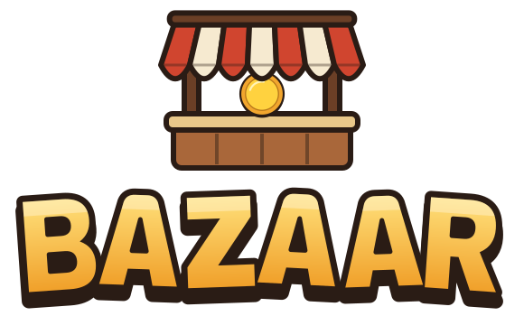

<p align="center"></p>

# Bazaar

A shop-keeping game on Solana devnet, built for the MagicBlock Solana Blitz v10 hackathon. You run a coffee house in an isometric market town: set your price, keep the shelves stocked, bid for wholesale stock, and read the numbers to beat the other coffee houses. Your shop, its money and its auctions are on-chain; the town around it is simulated in the browser.

Program (devnet): [`GT36pVzQ6NczDeJaL317uGsx1fT1SaKpvSvzUjaPqKTb`](https://explorer.solana.com/address/GT36pVzQ6NczDeJaL317uGsx1fT1SaKpvSvzUjaPqKTb?cluster=devnet)

## How it plays

- Each shopper wants one thing, shown over their head. The mix shifts through the day (coffee in the morning, food at lunch).
- Shoppers have a budget and pick among shops selling what they want, weighing price, foot traffic and brand.
- Rivals restock overnight and raise or cut prices depending on how their day went.
- Every shop has analytics: sales, market share, shoppers by hour, why they went elsewhere. Yours adds profit and a price advisor.
- Without a wallet the game runs in practice mode, entirely in the browser.

## MagicBlock

| Feature | What the game uses it for |
|---|---|
| **Session keys** | One wallet approval, then every game transaction is signed by a program-scoped session key (6 days) |
| **Ephemeral Rollup** | The shop and its ledger are delegated; repricing, customer payments, restocking, upgrades, auctions and events run on `devnet.magicblock.app` |
| **Undelegate and settle** | The **Settle** button returns the shop to devnet, pays your GD into your token account and delegates again |
| **VRF** | Draws the three rival bids in each auction after yours is locked in, and a city event every 60 s |

### Verified on devnet (26 Nov 2026)

| Step | Layer | Example transaction |
|---|---|---|
| Create session | devnet | [3XA1xUBt…](https://explorer.solana.com/tx/3XA1xUBtBcE2vGNvKtSwqQGTMb86siJuSgyWNrQDSVcDoKyk5WU7vR1BLPBpypjk1JWFHxfLqeGb6LUWbfJcd4MX?cluster=devnet) |
| Delegate shop | devnet | [47HeuYUi…](https://explorer.solana.com/tx/47HeuYUiUgpeBRraGCUJtZJhZSEeZzUyBaDndPtbuuKAsXesUFHGLxHzXvgyvKRUkM51rYHXDcYtFW1DTELKk2yu?cluster=devnet) |
| Reprice | rollup | [5yMs26PU…](https://explorer.solana.com/tx/5yMs26PU4h9XU68NYdbpESpHEq825iQpMeoBenZ4dkYDm3pExsAoyrHaCpTCBLYcmLteBf1SCyg9R1poAYcsse8r?cluster=custom&customUrl=https%3A%2F%2Fdevnet.magicblock.app) |
| Customers pay | rollup | [2zm1Ybgm…](https://explorer.solana.com/tx/2zm1YbgmivjJih2Qd2GeKXKV6Lqp6Y4JgrVNqDxEWnMoivMbtq4y4EW3EQmwwTt3sfsats9FZZJ9kAyd18gz57gE?cluster=custom&customUrl=https%3A%2F%2Fdevnet.magicblock.app) |
| Auction bid | rollup | [3VAFTMja…](https://explorer.solana.com/tx/3VAFTMjaJi2dYfjn29XJeDNarXwrPBGiPTrGSQ8Q9ncUoXdtUtUMRF7jwFgpn9VJNLmz99iiq26Lq22B2pSRmk8X?cluster=custom&customUrl=https%3A%2F%2Fdevnet.magicblock.app) |
| VRF answers the auction | rollup | [4DyrNWw1…](https://explorer.solana.com/tx/4DyrNWw16ihkQcvs753Bf6xAojKwiYY1m14HLm7iysYCM8TFvQYU4b9s5L5bd3pPEeMSRT2sfGvf41CXM5cLNzHC?cluster=custom&customUrl=https%3A%2F%2Fdevnet.magicblock.app) |
| City event request | rollup | [4ZFz87fS…](https://explorer.solana.com/tx/4ZFz87fSxaGnuv2D76eGAmJeSRWJydE1wPtob64cDZhLYiMzG3ukPaD9WBNpu6UtCx1iebjDaGkeFicp781DknoQ?cluster=custom&customUrl=https%3A%2F%2Fdevnet.magicblock.app) |
| VRF answers the event | rollup | [23uAgDeD…](https://explorer.solana.com/tx/23uAgDeDgoLxF38QzSg9CAhYSwf4DKpjBLePSZ8m2pbVTKnmrTPTrniZc3rR7yiK4rwsJXqzr2DZyjnzGDKf1LUV?cluster=custom&customUrl=https%3A%2F%2Fdevnet.magicblock.app) |
| Undelegate | rollup | [5VNw2CvK…](https://explorer.solana.com/tx/5VNw2CvKaYs1b7VMcAbWpRJ2Xanijq4bZix2wdoQ9FALGo3ttqkTwY2QgNXDmHEfXsgj2bugn8qRVE4jDtrrLNS9?cluster=custom&customUrl=https%3A%2F%2Fdevnet.magicblock.app) |
| Settle | devnet | [48mWCaWw…](https://explorer.solana.com/tx/48mWCaWwyYVbuYehvGA4HJcpqDWXRzHGVW7y4VVBw1gG3h1gAVqaRDCcQuu1EsQMuSCK6pPKQtomWSm8teCWPHgC?cluster=devnet) |

Rollup history is not kept forever, so older rollup links may stop resolving.

### Known gaps

- **State reaches devnet only on Settle.** Delegation asks for a commit every 30 s, but no periodic commits were observed on devnet: between settles, the devnet copy of the shop is stale. The program has a `commit_shop` instruction that the client does not call yet.
- **Restock and upgrades on the rollup** are tested locally; no devnet rollup transaction for them has been seen yet.
- **Not used:** Private ER, cranks, Magic Actions, Ephemeral SPL, Pyth Lazer.

## On-chain and off-chain

| On-chain | In the browser |
|---|---|
| GD, an SPL token (2 decimals), 10,000 minted when you join; held in program-owned accounts | Shoppers, their budgets and choices |
| Your plot (3,000 GD) and shop (2,000 GD), price, stock, upgrades | Rival shops and their prices |
| Customer payments from the town treasury | The day clock and analytics |
| Wholesale auction and its VRF result | Effect of a city event on demand (the draw itself is on-chain) |
| Pyth SOL/BTC signals stored every 5 minutes | Nothing reads those signals yet |

Demand is decided by the client and the program trusts it, so a player can pay themselves from their own season's treasury. Bids are public on the rollup. Full detail: [GAME_MECHANICS.md](GAME_MECHANICS.md).

## Run it

Needs Node 20+, a Solana wallet set to devnet, and a little devnet SOL (the session takes 0.04 SOL for fees).

```bash
cd client
npm install
npm run dev
```

Open http://localhost:5173, choose **Select Wallet**, then **Start session**.

Optional settings in `client/.env.local`:

| Variable | Purpose |
|---|---|
| `PYTH_API_KEY` | Live SOL price and market signals. Injected by the Vite dev/preview proxy, never bundled |
| `VITE_RPC_URL` | Base RPC (default `https://rpc.magicblock.app/devnet`) |
| `VITE_ER_URL` | Rollup RPC (default `https://devnet.magicblock.app`) |
| `VITE_ER=off` | Play on devnet without the rollup (auctions and events need it) |

Static hosting (for example Vercel, root directory `client`) serves the game, but the `/hermes` Pyth proxy exists only in the Vite servers, so the price feed needs a serverless replacement there.

## Program

Anchor 1.2.2, in `programs/bazaar/`.

```bash
yarn build                      # anchor build --arch v0 (SBPF v3 is not active on devnet)
cargo test -p bazaar            # program unit tests
node client/scripts/gen-idl-spec.mjs   # after changing instructions
cd client && npm run check      # demand model checks
```

Upgrade the deployed program (needs the upgrade authority):

```bash
solana program deploy target/deploy/bazaar.so --program-id GT36pVzQ6NczDeJaL317uGsx1fT1SaKpvSvzUjaPqKTb -u https://rpc.magicblock.app/devnet
```

To test the rollup locally: run `mb-test-validator` (from `@magicblock-labs/ephemeral-validator`) with Agave 4.2.2 first on `PATH`, then `ephemeral-validator --remotes localhost --listen 127.0.0.1:7799`, and start the client with `VITE_RPC_URL=http://127.0.0.1:8899 VITE_ER_URL=http://127.0.0.1:7799`. The local VRF program charges a fee on its rollup test queue, so VRF was tested on the local base chain with `anchor build --arch v0 -- --features localnet`. Never deploy that build.

## Layout

| Path | Contents |
|---|---|
| `programs/bazaar/src/` | Program: instructions and state |
| `client/src/solana/` | Wallet session, transactions, rollup routing |
| `client/src/engine/` | PixiJS town, map signs, demand model |
| `client/src/components/` | Panels: shop, analytics, town board, auction, guide |
| `client/art-src/` | Art and logo generators |
| `keeper/`, `tests/` | Left over from an earlier design; they do not work with this program |
